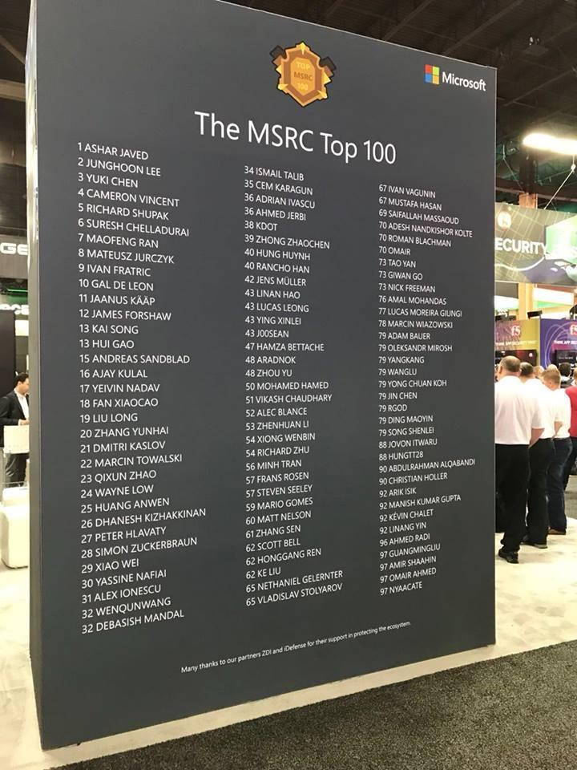

# Security Research & Vulnerability Disclosures

Public security research focused on **telecommunications security, 2G/3G/4G/5G networks, protocol fuzzing, vulnerability discovery, and cloud-native network infrastructure**.

This repository serves as a public portfolio of published CVEs, coordinated vulnerability disclosures, security issues reported to open-source projects and commercial vendors, and technical publications.

## Awards & Recognition

| Year | Recognition | Details |
|---|---|---|
| 2018 | Microsoft MSRC Top 100 Security Researchers | Ranked #36 (tied) at Black Hat USA — [Official Recognition](https://www.microsoft.com/en-us/msrc/blog/2018/08/microsofts-top-100-security-researchers-black-hat-2018-edition) |
| 2017 | Bugcrowd MVP Researcher | Recognized in Bugcrowd's annual MVP program — [Announcement](https://www.bugcrowd.com/blog/today-we-recognize-our-2017-mvp-researchers/) |
| 2017 | Bugcrowd Buggy Awards Finalist | Top Kudos Points category — [Announcement](https://www.bugcrowd.com/blog/2nd-annual-buggy-awards-finalists-announcements/) |
| 2017 | Bugcrowd Hall of Fame | Ranked #2 in June — [Leaderboard](https://www.bugcrowd.com/blog/june-2017-hall-of-fame-results/) |
| 2016 | Bugcrowd Hall of Fame | Ranked #3 in June — [Leaderboard](https://www.bugcrowd.com/blog/june-2016-leaderboard/) |

**Bugcrowd Researcher Profile:** [Web_Plus](https://bugcrowd.com/h/Web_Plus)

Microsoft MSRC Top 100 — Black Hat USA 2018

## Published CVEs

### Ella Core — 5G Core Network

Research focused on vulnerabilities in AMF processing of NGAP and NAS signaling messages, leading to application crashes and denial-of-service conditions.

| CVE | Vulnerability | Severity | Advisory |
|---|---|---|---|
| CVE-2026-32319 | AMF DoS via undersized integrity-protected NAS payload | High | [GHSA](https://github.com/advisories/GHSA-m9pm-w3gv-c68f) |
| CVE-2026-32320 | AMF DoS via malformed NGAP PathSwitchRequest with empty NR security capabilities | Moderate | [GHSA](https://github.com/advisories/GHSA-j478-p7vq-3347) |
| CVE-2026-33281 | AMF panic triggered by invalid PDU Session IDs | Moderate | [GHSA](https://github.com/advisories/GHSA-q669-4gmv-g8mf) |
| CVE-2026-33282 | AMF panic triggered by malformed NGAP Location Report | High | [GHSA](https://github.com/advisories/GHSA-826q-wrq4-p23x) |
| CVE-2026-33283 | AMF panic triggered by malformed ULNASTransport message | Moderate | [GHSA](https://github.com/advisories/GHSA-3366-gw57-fcm5) |

**Research areas:** 5G Core security, NGAP/NAS protocol fuzzing, input validation, robustness testing, and denial-of-service vulnerabilities.

[View original GitHub researcher credits](https://github.com/advisories?query=credit%3Ap1-aji)

### free5GC — 5G Core Network

**CVE-2022-38870 — Unauthenticated Subscriber Information Disclosure**

Discovered an authentication weakness in the free5GC webconsole exposing registered UE information, subscriber data, tenant details, and user information without authentication.

**References:**
- [CVE-2022-38870 — NVD](https://nvd.nist.gov/vuln/detail/CVE-2022-38870)
- [Original Vulnerability Report — GitHub Issue #387](https://github.com/free5gc/free5gc/issues/387)

**Research areas:** Authentication weaknesses, sensitive information disclosure, and 5G Core management interface security.

### Ericsson Packet Core Controller (PCC)

**CVE-2025-59180 — Hardcoded Credentials in the Alarm System**

Security vulnerability involving hardcoded credentials in the Ericsson Packet Core Controller alarm system, allowing an attacker with cluster access and knowledge of the credentials to read alarm and alert information.

**References:**
- [CVE-2025-59180 — Official CVE Record](https://www.cve.org/CVERecord?id=CVE-2025-59180)
- [Ericsson PSIRT Security Bulletin — July 2026](https://www.ericsson.com/en/about-us/security/psirt/security-bulletin-pcc-july-2026)

**Research areas:** Hardcoded credentials, authentication weaknesses, and cloud-native telecommunications infrastructure security.

---

## Public Vulnerability Reports

### Open5GS — 4G/5G Core Network

Vulnerabilities identified through protocol-aware fuzzing and malformed signaling message testing.

| Issue | Finding | Original Report |
|---|---|---|
| #4341 | SMF crash when parsing malformed Extended Protocol Configuration Options (EPCO) during PDU Session Establishment | [GitHub Issue #4341](https://github.com/open5gs/open5gs/issues/4341) |
| #4357 | MME crash triggered by malformed S1AP/NAS Attach Request | [GitHub Issue #4357](https://github.com/open5gs/open5gs/issues/4357) |

**Research areas:** S1AP/NAS message processing, EPCO parsing, protocol robustness, and denial-of-service vulnerability discovery.

---

## Publications & Technical Writing

### Fuzzing the Mobile Core: How Malformed 5G/4G Signaling Crashes Production Networks

**Published:** May 7, 2026  
**Publisher:** P1 Security  
**Category:** Telecommunications Security Research

Technical research article authored during my time at P1 Security, examining how malformed signaling messages can expose security vulnerabilities and crash mobile core network functions.

The publication covers:

- Protocol-aware fuzzing of 4G/5G mobile core networks.
- Security testing of NGAP, NAS, PFCP, and HTTP/2 service-based interfaces.
- Vulnerability discovery through malformed signaling messages.
- Root cause analysis of parser bugs, assertion failures, and application panics.
- Real-world vulnerability case studies involving Ella Core.
- Implications for mobile network availability and resilience.

**[Read the full article — P1 Security](https://www.p1sec.com/blog/fuzzing-the-mobile-core-how-malformed-5g-4g-signaling-crashes-production-networks)**

---

## Research Focus

### Telecommunications Security

| Domain | Technologies & Protocols |
|---|---|
| 2G / GSM | GSM, GPRS, SS7, MAP, SCCP, SIGTRAN |
| 3G / UMTS | UMTS, SGSN, GGSN, SS7, MAP, GTP |
| 4G / LTE | EPC, MME, SGW, PGW, HSS, S1AP, NAS, Diameter, GTP |
| 5G | 5GC, AMF, SMF, UPF, NRF, AUSF, UDM, NGAP, PFCP, SBI |
| Cloud-Native Infrastructure | Kubernetes, OpenShift, Linux, Containers |
| Network & API Security | SCTP, TCP/IP, TLS, HTTP/2, REST, gRPC |

### Security Research & Testing

- Telecom signaling protocol fuzzing and robustness testing.
- Vulnerability discovery, validation, and root cause analysis.
- Mobile core and radio access network security assessments.
- Authentication, authorization, and information disclosure testing.
- Cloud-native network function penetration testing.
- Coordinated vulnerability disclosure and technical reporting.

### Tools & Technologies

`Python` · `Scapy` · `Wireshark` · `tcpdump` · `Nmap` · `Burp Suite` · `boofuzz` · `Linux` · `Docker` · `Kubernetes` · `OpenShift` · `Open5GS` · `UERANSIM`

---

## Research Attribution

Some of the vulnerabilities and security reports documented in this repository were originally disclosed through my former professional GitHub account [@p1-aji](https://github.com/p1-aji) during my time at P1 Security.

The original security advisories, GitHub issues, and vendor bulletins remain the authoritative references for published vulnerability details and disclosure history.

This repository provides a personal index of publicly disclosed security research and technical publications.

---

[**Back to GitHub Profile — AH-M-ED**](https://github.com/AH-M-ED)
